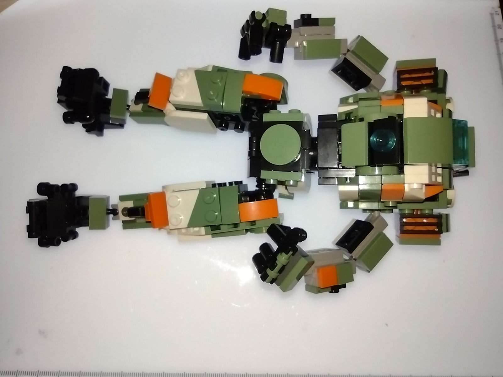
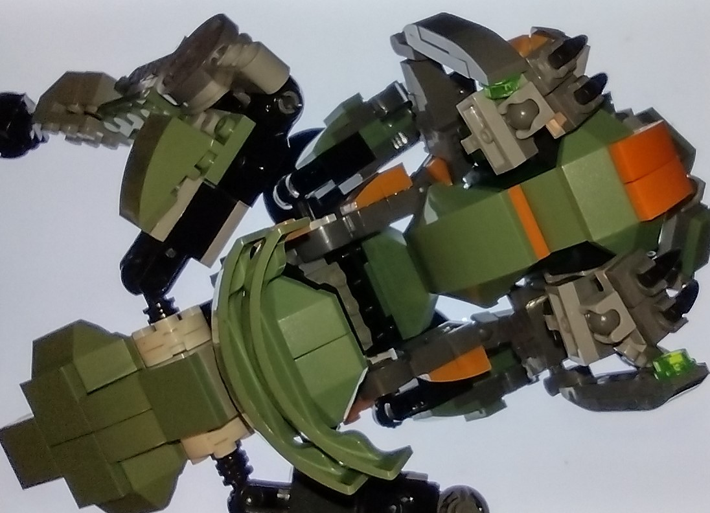
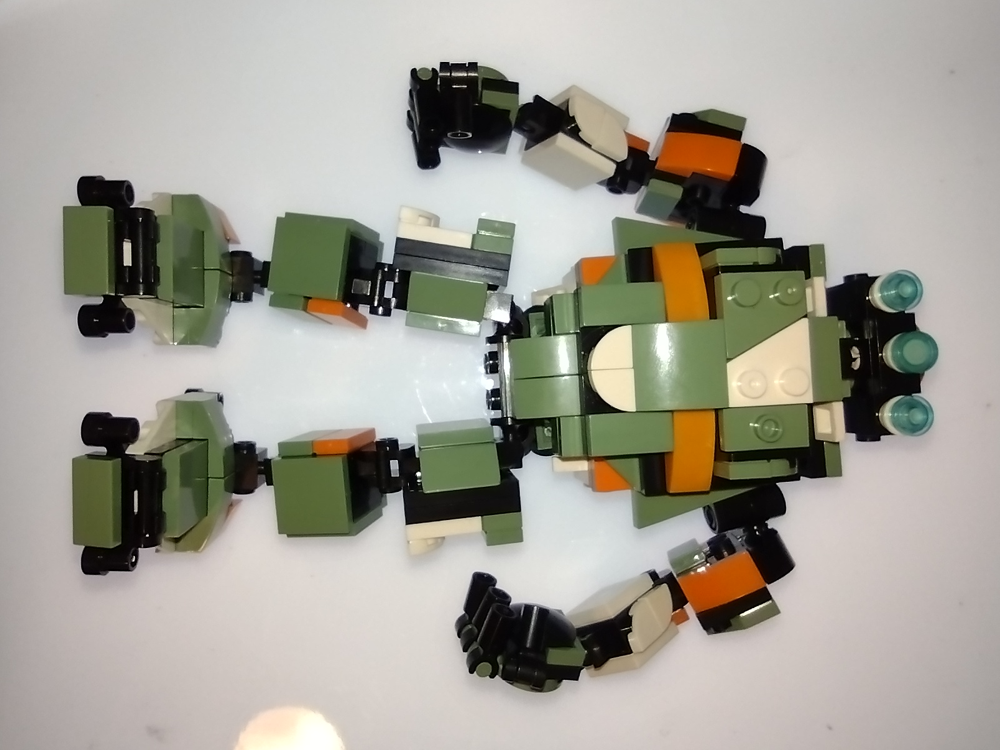
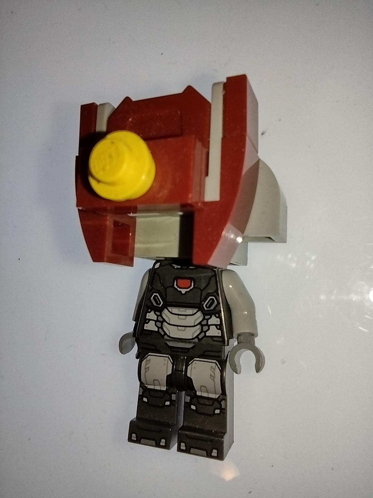

# Transmigration in a Bounded Space

## Part 1. The pieces have to interlock

Take the problem of being original in a strict space. LEGO and LEGO-like pieces have to interlock. Each build uses a finite number of pieces, and in practice I have a limited inventory. The possible arrangements are what I call *infinitely finite*. Each construction is bounded, but the number of ways to build grows as I find new relationships between the pieces.

In my micro-build universe, the **1×1 flat and the 1×2 flat are atomic**. With the ordinary pieces I am using, I cannot build sideways. The rare **1×1 with a side connector** changes that. It is a small piece that opens a new direction of attachment.

Add the **2×2, 2×3, 3×3, and 4×4 flats**, and I can build larger forms without losing the detail of a micro-build. A small number of purely cosmetic pieces can change what the structure expresses. The bounds are still there. The pieces still have to fit.

## Part 2. Humucus in Hiding

The green and orange run through all three images. Look past the colors and each build carries something different forward.

### Image 1. The stock build

This is the stock arrangement and its parts together. [Stock-build listing supplied for comparison](https://www.ebay.com/itm/147606228686)

### Image 2. Humucus in Hiding

The first Humucus lacked understanding. The completely original build was the **point of transmigration**. The newer Humucus uses parts from entirely different sets. The green and orange make him look related to the other builds at first glance. Look at what the parts are and how they fit, and the resemblance is in the color.

**For better or for worse, he is Humucus.** Humucus carries a homunculus.

### Image 3. Stock parts on a MyBuild frame

Here the stock parts carry over. They are rearranged on a MyBuild frame. The frame gives the familiar pieces different places to connect and a different form to express. Alongside Humucus, this shows the difference between carrying parts forward and carrying forward a color aesthetic while composing with a different set of parts.

## Part 3. Micro-construction on a 2×2×1 solid block

This is a separate micro-construction. The **2×2×1 solid block** is the core of the head assembly. The pieces around it can extend beyond that core. The red sets the outline, the pale pieces interrupt it, and a single round yellow piece gives the face a focal point. On the minifigure body, those few choices are enough to give the figure a character of its own.
