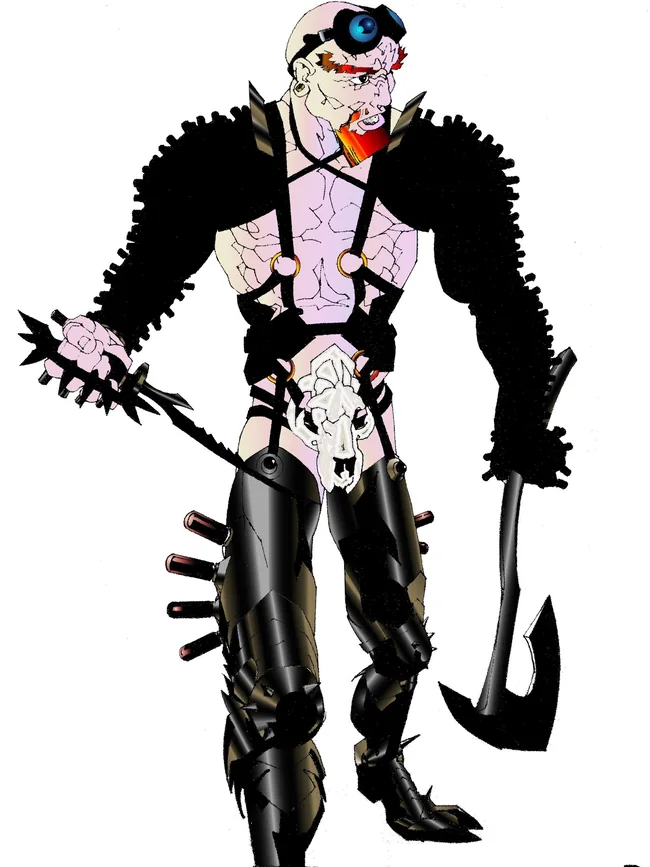
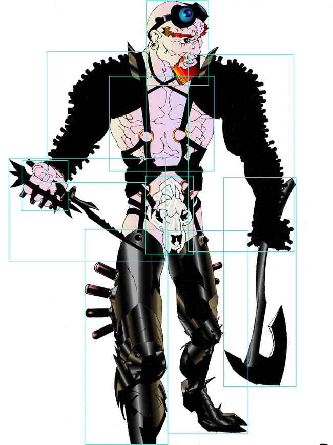
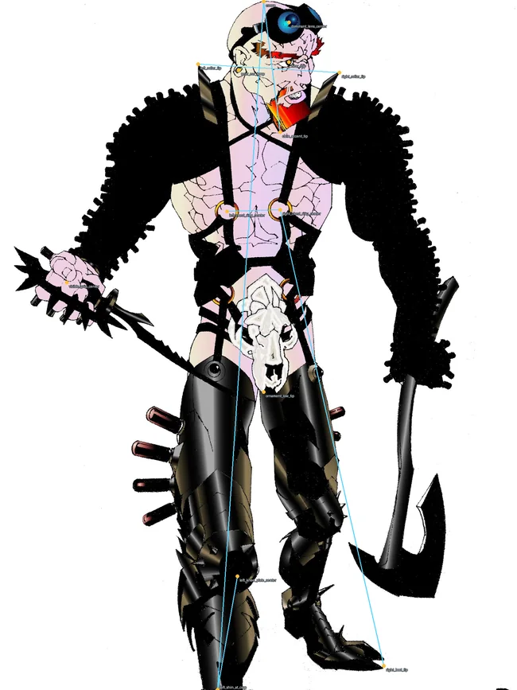
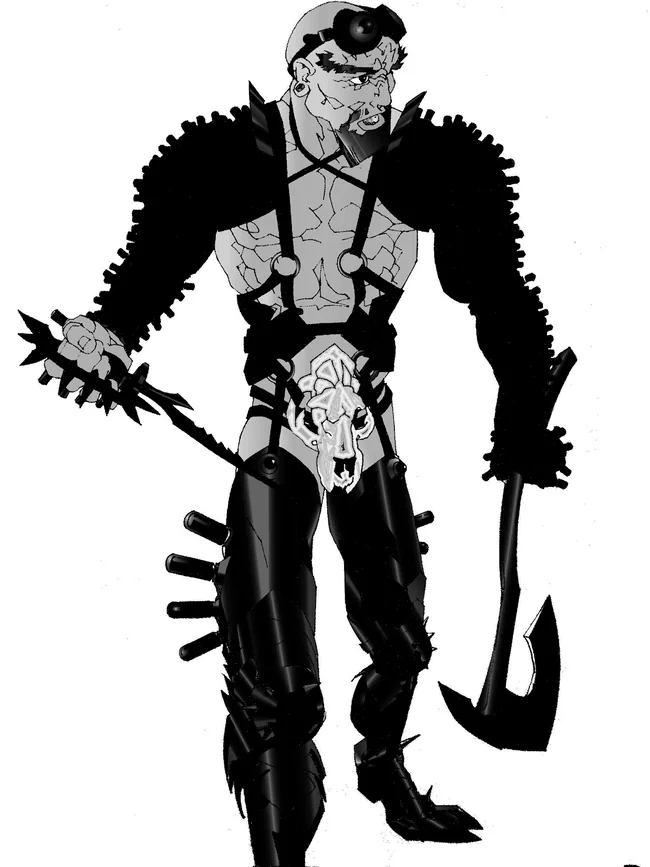
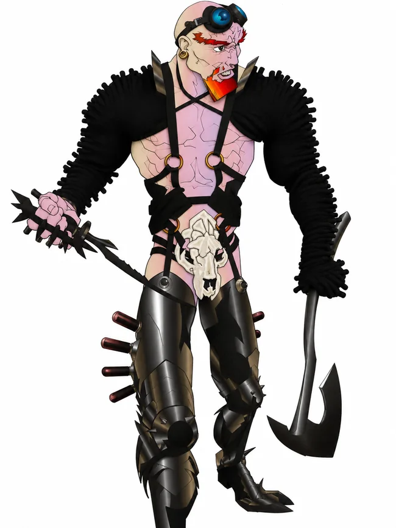
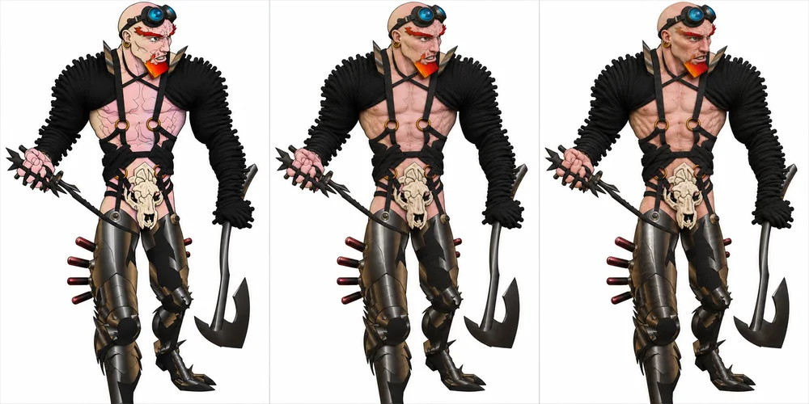
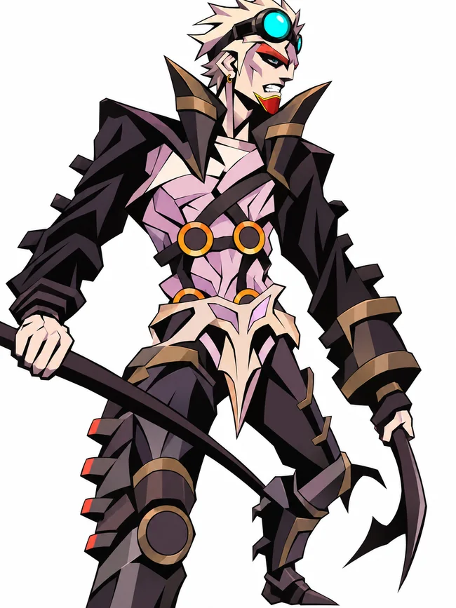

# Visual Decomposting of Allowed Work

*An armored figure rebuilt from description and color data*

An armored figure begins as a drawing. Its image is archived and restored, then studied through composition, proportions, and color. A separate rebuild takes the written description and JSON color information as its working material. The new figure still has the cyan optic, red facial accents, and circular knee plate. It also has spiked hair, sharply faceted armor, and a hand the original drawing kept hidden. Those differences make it possible to examine what survived the passage from image to description and back to image.

## See the process

### 1. Original drawing and exact restoration

| Uploaded drawing | Rebuilt from JSON raster tiles |
| --- | --- |
|  |  |

The two images look the same because every decoded RGBA sample matches. The reconstruction image on the right came from the tiles. The images on this page are resized WebP previews.

### 2. Composition, proportion, and color

| Composition | Proportion | Relative luminance |
| --- | --- | --- |
|  |  |  |

The overlays place inspection windows and proportion landmarks back over the source so their coordinates are easy to read. The grayscale layer shows relative luminance calculated under an sRGB assumption. The color study also records RGB swatches and tile statistics.

### 3. Image-guided realization

*First pass.* The drawn contours and color blocks remain prominent while the sleeves, metal, and skin gain some depth.

*Later passes, left to right.* Skin and facial features become more natural while the costume, stance, and crop carry through. These passes used image references.

### 4. Description-led recomposition

The supplied rebuild was made from a text description and JSON color matching, according to its contributor. Compare the cyan optic, red accents, and round knee plate with Stage 1. The spiked hair, exposed hand, and faceted armor show where the new build diverges.

## Decomposting as recovery and recomposition

This exercise uses artwork that was allowed for the study and rebuild. That permission is the starting condition for the method. Recovery means identifying what can be described or measured in the source, with its provenance intact. Recomposition means using selected findings as material for a new construction. The source remains available for comparison, and permission for the original exercise does not establish permission for further distribution.

A useful distinction emerges from the process. Exact restoration answers whether a record can return the source. Creative recomposition asks what a new build can carry when it starts from a reduced set of observations. Both were part of the exercise, and each has its own evidence.

## The process

| Stage | What happened | What we learned |
| --- | --- | --- |
| Preserve | The 1536 × 2048 drawing was archived as original PNG bytes and as 768 independently checksummed RGBA tiles. | The PNG was restored byte for byte. A separate reconstruction from the tiles reproduced every decoded RGBA sample. |
| Study | Composition records mapped regions, overlap, and crop. Proportion records located manually placed landmarks. Color records captured samples, tile statistics, and relative luminance. | Measurements made some relationships explicit. Hidden surfaces, absolute depth, and the cropped foot remained unresolved. |
| Explore | Image-guided passes gradually humanized the figure and explored angles of the head, torso, arms, and legs. | The studies explored continuity across rendering styles and views. Newly visible geometry was inferred from the available images. |
| Recompose | The final rebuild was made from text description and JSON color matching, according to the person who supplied it. | The result provides a visible case for comparison. The exact submitted prompt and selected JSON fields were not independently verified for this README. |

The description-led rebuild is the point in the exercise where we can examine visual transmigration. The final image carries a recognizable set of features into a new construction. The earlier image-guided passes help explain the method and give us comparison material. Their existence does not establish the input history of the final run.

## What carried through

| Feature | What recurred | What the rebuild changed |
| --- | --- | --- |
| Face | A dominant cyan optic, red brow and chin accents, and a right-facing grimace | Pale hair spikes replace the bald crown and reach the upper frame. |
| Sleeves and harness | Dark sleeves, crossed straps, and warm gold rings | Broad angular surfaces and block-like projections replace the smaller repeated sleeve details. |
| Waist and legs | A pale waist ornament, round forward knee, and four red accents along the outer thigh | The ornament becomes a pointed emblem. The armor plates and stance are reworked in sharper, flatter shapes. |
| Grip and framing | A diagonal form, a hooked contour, and a white field | The second hand becomes visible where a cuff previously obscured the grip. |

The palette carries some of the figure’s identity because its colors still have related jobs. Cyan draws attention to the optic. Red concentrates at the face and repeats on the thigh. Gold picks out the rings against the dark harness. These are observations from the images. They establish visible relationships, while exact color agreement would require comparing defined samples under the same color-space assumptions.

The changes matter just as much. For restoration, a bald crown and an obscured hand are facts of the source. In the recomposition, the hair and revealed hand show where the new image made decisions beyond those facts. That is where the limits of the description become visible.

## Repeating the exercise

1. Start with work you are allowed to study and recompose. Record its provenance and the scope of that use.
2. Preserve the source and verify that the archive can produce it again.
3. Describe the arrangement and record selected proportions and color samples. Mark observations, measurements, and unknowns in the study.
4. Freeze the generation brief before running it. Export only the intended text and JSON fields. An archival JSON can contain complete encoded pixels, so passing the whole file changes what the experiment tests.
5. Retain the submitted brief and output together. Compare the result with the source and record preserved features, newly composed features, and open questions.

The archive makes recovery verifiable. The rebuild makes recomposition visible. Together they show which parts of this figure could be carried forward as descriptions and measurements, and where the new image had room to take shape.
